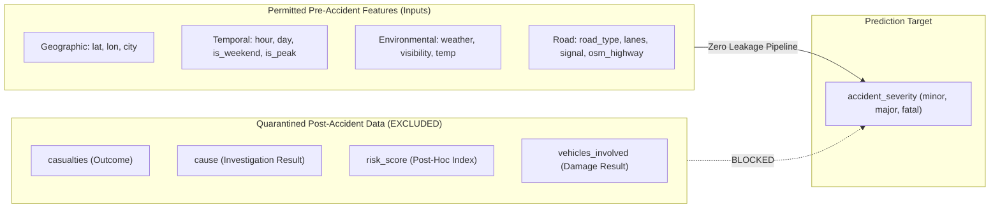

# AccidentVision AI — Road Accident Risk Intelligence Platform

[](https://www.python.org/)
[](https://scikit-learn.org/)
[](https://streamlit.io/)
[](https://plotly.com/)
[](https://opensource.org/licenses/MIT)

> **Scientific Transparency Notice:** AccidentVision AI is a rigorous, defensible data intelligence platform. It prioritizes data integrity, spatial crash clustering, and trustworthy empirical evaluation over inflated predictive claims. Pre-accident environmental and road features exhibit low mutual information with injury severity (baseline balanced accuracy ~32.6%, fatal recall ~10.7%). The system is designed for exploratory research and municipal planning, not deterministic crash forecasting.

---

## 1. Project Overview & Problem Statement

Road traffic collisions present major public health and municipal planning challenges across Indian metropolitan corridors. **AccidentVision AI** provides an end-to-end analytical framework to:
- Map where historical collisions are spatially concentrated across 8 metropolitan centers.
- Examine how collision volume correlates with urban road types, lane counts, and time of day.
- Audit data quality, geographic bounding accuracy, and potential data leakage.
- Evaluate whether pre-accident features (weather, visibility, road infrastructure, time) possess genuine predictive power for crash severity.
- Provide a full-featured, professional Streamlit intelligence dashboard with interactive spatial filtering and research inference.

---

## 2. Dataset Sources, Provenance & Verification Status

| Dimension | Details |
|---|---|
| **Master Dataset** | `Data/accident_master_osm.csv` (20,000 records, 28 columns) |
| **Raw Baseline** | `Data/Accidents/indian_roads_dataset.csv` (20,000 records, 24 columns) |
| **Public Origin** | Associated with `https://github.com/Aditya2213/INDIAN_ROAD_ACCIDENT_DATASET_DASHBOARD` |
| **Authenticity Status** | **Unverified Research Benchmark.** Records possess valid WGS84 coordinates and plausible timestamps, but individual crashes cannot be cross-referenced to official state police FIRs. |
| **Temporal Coverage** | January 1, 2022 to April 15, 2025 (continuous calendar records) |
| **Geographic Scope** | 8 Urban Centers: Bangalore, Chandigarh, Chennai, Delhi, Hyderabad, Kolkata, Mumbai, Pune |
| **OSM Enrichment** | 15,425 records (77.1%) spatially joined with OpenStreetMap highway vectors (`osm_highway`, `osm_road_length_m`, `distance_to_road_m`) |

---

## 3. Data Dictionary & Strict Leakage Quarantine

To eliminate data leakage, all features were audited for their exact temporal availability relative to the crash event:



### Quarantined Fields (Excluded from Pre-Accident Predictor):
- **`casualties`:** Observed strictly after the crash. 4,925 records in the dataset have 0 casualties (all minor or major), whereas fatal crashes strictly have $\ge 1$ casualties (mean 3.0). Using casualties introduces direct outcome leakage.
- **`cause`:** Determined post-hoc following police/traffic investigation.
- **`risk_score`:** Possesses only 18 discrete values and is strongly correlated with fatal outcomes ($r > 0.40$). Lacks documented pre-event formulas.
- **`vehicles_involved`:** Result of the physical impact.
- **`festival`:** Missing in 99.43% of records (only 115 non-null rows).

---

## 4. Machine Learning Benchmarks & Independent Evaluation

### Evaluation Protocol
- **Training Period:** 2022–2023 (12,205 records)
- **Validation Period:** 2024 (6,061 records)
- **Final Holdout Period:** 2025 (1,734 records, evaluated once without tuning)
- **Spatial Evaluation:** Leave-One-City-Out Cross-Validation (LOCO-CV) across all 8 cities

### Benchmark Results (2024 Validation Set)

| Candidate Model | Accuracy | Balanced Accuracy | Macro F1 | Weighted F1 | Fatal Recall | Major Recall | Minor Recall |
|---|---|---|---|---|---|---|---|
| **Majority Baseline** | **0.5512** | 0.3333 | 0.2369 | 0.3918 | 0.0000 | 0.0000 | **1.0000** |
| **Stratified Baseline** | 0.4169 | **0.3341** | **0.3342** | 0.4172 | 0.1492 | 0.2975 | 0.5552 |
| **Logistic Regression** (Balanced) | 0.3349 | 0.3346 | 0.3140 | 0.3424 | **0.3449** | 0.3014 | 0.3502 |
| **Random Forest** (Depth=12) | 0.4455 | 0.3252 | 0.3182 | 0.4285 | 0.0681 | 0.2529 | 0.6534 |
| **Extra Trees v1 / v2** (Leaf=3) | 0.4268 | 0.3260 | 0.3243 | 0.4148 | 0.1070 | 0.2730 | 0.5980 |
| **Hist Gradient Boosting** | 0.3564 | 0.3221 | 0.3151 | 0.3649 | 0.2011 | 0.2830 | 0.4388 |

### Spatial Leave-One-City-Out (LOCO-CV) Results
- **Mean Spatial Macro F1:** `0.3288` ($\pm 0.0133$)
- **Mean Spatial Fatal Recall:** `0.0865` (8.65%)
- Across all 8 held-out cities, models demonstrate near-zero spatial transferability, confirming that pre-accident road and weather tags do not generalise across different city geometries.

### Scientific Conclusion: The Fatal Recall Reality
Complex tree ensembles fail to outperform naive baselines in balanced accuracy (~32.6% vs 33.3% random chance) and miss **~89.3% of all fatal crashes**. The physics of collision severity (impact speed, vehicular mass ratio, seatbelt usage, barrier deflection) are unobservable in pre-accident metadata. The model is therefore classified as an **exploratory prototype**.

---

## 5. Geospatial Analytics & Hotspot Methodology

AccidentVision AI employs **DBSCAN with Haversine geodesic metric** ($\varepsilon = 500\text{m}$, $\text{min\_samples} = 15$) to detect collision clusters without circular distortion.

### Crucial Distinction: Concentration vs True Risk
- **Observed Count / Density:** Measured by the system. Identifies corridors with high collision frequency (e.g. Western Express Highway in Mumbai, Outer Ring Road in Bangalore).
- **Exposure-Adjusted Risk:** Requires vehicle-kilometers traveled (VKT) or annual average daily traffic (AADT) denominators. Without volume counts, raw tallies must never be presented as true individual hazard.

---

## 6. Architecture & File Structure

```text
AccidentVision AI/
├── Data/                             # Preserved source datasets
│   ├── accident_master_osm.csv       # Master 20k dataset with OSM features
│   ├── Accidents/                    # Raw original CSV
│   ├── Population/                   # WorldPop raster TIFFs (2015-2030)
│   ├── Road/                         # OSM extracts and road CSVs
│   └── Weather/                      # ERA5 GRIB and regional weather CSVs
├── Models/
│   └── severity_extra_trees_v1/      # Preserved legacy baseline model & metadata
├── models/
│   └── severity_v2/                  # New Scikit-Learn 1.8 native model & metadata
├── src/                              # Modular engineering package
│   ├── __init__.py
│   ├── data_validation.py            # Defensive schema and coordinate auditing
│   ├── preprocessing.py              # Zero-leakage pipelines & legacy unpickler bridge
│   ├── feature_engineering.py        # Cyclical temporal & log geometry features
│   ├── train.py                      # Candidate benchmark & LOCO-CV runner
│   ├── evaluate.py                   # Classification, calibration & spatial metrics
│   ├── geospatial.py                 # DBSCAN haversine clustering & grid density
│   └── inference.py                  # Production-ready inference engine
├── app/
│   └── streamlit_app.py              # Interactive 7-tab intelligence dashboard
├── reports/
│   ├── data_quality/                 # DATA_QUALITY_AUDIT.md
│   ├── evaluation/                   # MODEL_EVALUATION_REPORT.md & CSV comparisons
│   └── geospatial/                   # HOTSPOT_INTELLIGENCE_REPORT.md
├── tests/                            # Pytest automated test suite
│   ├── test_data_validation.py
│   ├── test_preprocessing.py
│   └── test_inference.py
├── requirements.txt
├── .env.example
├── .gitignore
├── LICENSE
└── README.md
```

---

## 7. Installation & Quickstart

### 1. Clone & Set Up Virtual Environment
```bash
# Clone the repository
git clone <repo-url> "d:/Studyy/Accident Vission AI"
cd "d:/Studyy/Accident Vission AI"

# Create and activate Python virtual environment
python -m venv venv
# Windows:
venv\Scripts\activate
# Linux/macOS:
source venv/bin/activate
```

### 2. Install Dependencies
```bash
python -m pip install -r requirements.txt
```

### 3. Run Automated Tests
```bash
python -m pytest tests/
```

### 4. Execute Training & Benchmark Pipeline
```bash
python -m src.train
```

### 5. Launch the Streamlit Intelligence Dashboard
```bash
streamlit run app/streamlit_app.py
```
Open your browser at `http://localhost:8501`.

---

## 8. Python Inference API

```python
from src.inference import SeverityPredictor

predictor = SeverityPredictor()

incident_payload = {
    "city": "Delhi",
    "latitude": 28.6139,
    "longitude": 77.2090,
    "hour": 21,
    "is_weekend": 1,
    "lanes": 4,
    "traffic_signal": 1,
    "temperature": 18.5,
    "is_peak_hour": 0,
    "road_type": "highway",
    "day_of_week": "Saturday",
    "weather": "fog",
    "visibility": "low",
    "traffic_density": "high",
    "osm_highway": "primary",
    "osm_road_length_m": 1400.0,
    "distance_to_road_m": 8.0,
    "road_match_quality": "High"
}

result = predictor.predict(incident_payload)
print(f"Predicted Severity: {result['predictions']['predicted_severity']}")
print(f"Class Probabilities: {result['predictions']['probabilities']}")
print(f"Transparency Notice: {result['disclaimer']}")
```

---

## 9. Limitations & Responsible Use

1. **Unverified Source Provenance:** The dataset must not be cited as official government accident statistics.
2. **Missing Denominators:** Do not interpret raw crash counts as individual route safety without traffic volume data.
3. **No Operational Automated Decisions:** Because fatal recall is ~10.7%, this model must never be used to deploy emergency services, prioritize infrastructure funding, or price insurance.
4. **No Causal Inferences:** Correlative patterns (e.g. more crashes during clear weather) reflect vehicle volume exposure, not that clear weather induces accidents.

---

## 10. License

This project is licensed under the MIT License — see the [LICENSE](file:///d:/Studyy/Accident%20Vission%20AI/LICENSE) file for details.
