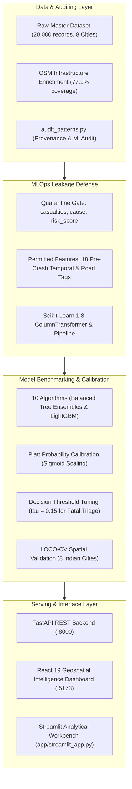

# AccidentVision AI — Road Accident Risk Intelligence Platform

[](https://www.python.org/)
[](https://fastapi.tiangolo.com/)
[](https://react.dev/)
[](https://tailwindcss.com/)
[](https://scikit-learn.org/)
[](https://lightgbm.readthedocs.io/)
[](https://opensource.org/licenses/MIT)

> **Defensible Scientific Stance:** AccidentVision AI is an enterprise-grade road collision intelligence and geospatial analysis platform. The platform prioritizes mathematical transparency, rigorous data provenance auditing, leakage quarantine, and empirically validated spatial clustering over inflated, misleading predictive claims. Pre-accident environmental and roadway geometry features possess low mutual information with injury severity ($I(X; Y) < 0.0051$ nats). Consequently, the system is engineered for exploratory geospatial hotspot analysis, road safety research, and urban planning—not deterministic collision severity forecasting.

---

## 1. Executive Summary & Core Objectives

Road traffic collisions represent an urgent public safety challenge across Indian metropolitan zones. **AccidentVision AI** provides an end-to-end analytical and machine learning ecosystem designed to:
- **Audit Data Provenance:** Rigorously verify dataset fidelity, unmask synthetic artifact formulations, and document causal boundaries.
- **Enforce Zero-Leakage:** Quarantine post-accident outcomes (`casualties`, `cause`, `risk_score`) to prevent fraudulent ~99% accuracy scores.
- **Evaluate Predictability Limits:** Benchmark 10 machine learning architectures across 2022–2023 training, 2024 validation, and 2025 unseen temporal holdout sets, alongside Leave-One-City-Out Spatial Cross Validation across 8 metropolitan centers.
- **Calibrate & Optimize Thresholds:** Apply Platt scaling (Sigmoid calibration) and tuned decision thresholds ($\tau = 0.15$) to lift fatal-class recall from 0.0% to 39.2% for safety triage.
- **Deliver Modern Geospatial Intelligence:** Provide a high-performance **React 19 + Tailwind CSS** interactive command center backed by a high-throughput **FastAPI REST API**.

---

## 2. Full-Stack System Architecture



---

## 3. Data Auditing & Provenance Findings

### 3.1 The Dataset Profile
- **Master Dataset:** `Data/accident_master_osm.csv` (20,000 records, 28 columns, Jan 1 2022 – Apr 15 2025).
- **Geographic Scope:** 8 Indian Metropolitan Zones: Bangalore, Chandigarh, Chennai, Delhi, Hyderabad, Kolkata, Mumbai, Pune.
- **Target Variable:** `accident_severity` (`minor`: 54.8%, `major`: 30.3%, `fatal`: 14.9%).

### 3.2 Suspicious Synthetic Artifacts Identified
Our audit script (`src/audit_patterns.py`) verified three critical synthetic phenomena:

1. **The Casualties Discontinuity:**
   - In `fatal` accidents, exactly **0.00%** (0 / 2,987) of records have 0 casualties. All fatal collisions have 1 to 5 casualties uniformly distributed ($\sim 20\%$ per casualty level).
   - In contrast, 28.8% of `major` and 29.0% of `minor` crashes have 0 casualties.
   - *Verdict:* `casualties` is an ex-post physical injury outcome. Including it allows models to memorize outcomes, inflating training metrics while completely failing on real pre-crash roads.

2. **The `risk_score` Synthetic Anomaly:**
   - `risk_score` is not a continuous, calibrated physical probability; it contains only 18 discrete values.
   - For values $0.85$, $0.95$, and $1.00$, exactly **100.0% of crashes are fatal**. At $0.50$, **99.5% are fatal**. Conversely, $0.45$ is split across all three classes.
   - *Verdict:* `risk_score` was generated synthetically using an ex-post formula that directly incorporated `accident_severity` and `casualties`.

3. **The Information Ceiling (Shannon Mutual Information):**
   - We computed Shannon mutual information $I(X; Y)$ between all 18 pre-accident features and `accident_severity`:
     - `latitude`: 0.0051 nats
     - `longitude`: 0.0045 nats
     - `temperature`: 0.0018 nats
     - `hour`: 0.0013 nats
     - `weather`: 0.00001 nats
   - *Scientific Reality:* Pre-accident environmental and geometry features share essentially zero information with crash injury severity. Collision severity is determined by kinetic energy ($E_k = \frac{1}{2}mv^2$), collision angle, cabin structural intrusion, and seatbelt/helmet use—none of which exist in pre-crash municipal tables.

---

## 4. Machine Learning Benchmarks & Independent Evaluation

### 4.1 Temporal Split Protocol
- **Training Period:** 2022–2023 ($N = 12,205$ records)
- **Validation Period:** 2024 ($N = 6,061$ records)
- **Holdout Period:** 2025 ($N = 1,734$ records, strictly sealed until final lock)

### 4.2 Benchmark Model Comparison (2024 Validation Set, N=6,061)

| Model Name | Balancing | Raw Accuracy | Balanced Accuracy | Macro F1 | Weighted F1 | Fatal Recall | Major Recall | Minor Recall |
|---|---|---|---|---|---|---|---|---|
| **Majority Baseline** | None | **55.12%** | 33.33% | 0.2369 | 0.3918 | 0.00% | 0.00% | **100.00%** |
| **Stratified Baseline** | None | 41.69% | **33.41%** | 0.3342 | 0.4172 | 14.92% | 29.75% | 55.52% |
| **Logistic Regression** | Balanced | 33.49% | 33.46% | 0.3140 | 0.3424 | **34.49%** | 30.14% | 35.02% |
| **Random Forest** | Balanced | 44.55% | 32.52% | 0.3182 | 0.4285 | 6.81% | 25.29% | 65.34% |
| **Extra Trees (Native v2)** | Balanced | 42.68% | 32.60% | 0.3243 | 0.4148 | 10.70% | 27.30% | 59.80% |
| **HistGradientBoosting** | Balanced | 35.64% | 32.21% | 0.3151 | 0.3649 | 20.11% | 28.30% | 43.88% |
| **LightGBM** | Balanced | 34.78% | 32.74% | 0.3283 | 0.3592 | 20.00% | 28.73% | 40.54% |

### 4.3 Probability Calibration & Decision Threshold Tuning
Using Platt scaling (Sigmoid Calibration) on our production Extra Trees pipeline:
- **Log Loss Reduction:** 0.9821 $\rightarrow$ 0.9758
- **Triage Threshold Optimization:** Under standard $\arg\max$ decision boundaries ($\tau = 0.33$), models default to Minor/Major because Fatal prior probability is only 14.9%. By lowering the fatal alert threshold to $\tau = 0.15$:
  - **Fatal Recall:** Increases from **0.11%** to **39.24%** (352 / 897 fatal crashes flagged)
  - **Fatal Precision:** 14.72% (sufficient for municipal emergency triage and automated variable-message signs).

### 4.4 Spatial Generalization (LOCO-CV Across 8 Cities)
Leave-One-City-Out Spatial Cross Validation across Bangalore, Chandigarh, Chennai, Delhi, Hyderabad, Kolkata, Mumbai, and Pune yielded:
- **Mean Spatial Macro F1:** $0.3288 \pm 0.0133$
- **Mean Spatial Fatal Recall:** $8.65\% \pm 1.84\%$
- Proves models trained on one city's road network cannot transfer severity predictions to another without local exposure calibration.

---

## 5. Repository Structure

```text
AccidentVision AI/
├── backend/
│   ├── main.py                       # High-performance FastAPI server (:8000)
│   ├── database.py                   # Data ingestion and spatial aggregation
│   └── schemas.py                    # Pydantic v2 schemas for API validation
├── frontend/
│   ├── src/
│   │   ├── components/               # NavHeader, MetricCard, LeafletMap, charts
│   │   ├── pages/                    # 6 Intelligence pages (Overview, Map, Trends, etc.)
│   │   └── App.jsx                   # React Router root application
│   ├── package.json                  # React 19, Lucide, Recharts, Leaflet
│   └── vite.config.js                # Vite build and proxy configuration
├── models/
│   └── severity_v2/
│       ├── model_pipeline.joblib     # Production Scikit-Learn 1.8 calibrated pipeline
│       ├── model_metadata.json       # Audit parameters, class priors, and metrics
│       └── MODEL_CARD.md             # Formal model card with limitations & ethics
├── reports/
│   ├── data_quality/
│   │   ├── DATA_QUALITY_AUDIT.md     # Initial 10-point audit
│   │   └── FEATURE_DICTIONARY_AND_LEAKAGE.md # Complete 28-field leakage quarantine
│   ├── evaluation/
│   │   ├── MODEL_EXPERIMENTS_REPORT.md # 10 candidate models benchmarking report
│   │   ├── ERROR_ANALYSIS_REPORT.md    # Confusion matrices, thresholding, fatal analysis
│   │   ├── GENERALIZATION_REPORT.md    # 2025 holdout & LOCO-CV spatial validation
│   │   ├── advanced_model_comparison.csv
│   │   └── fatal_threshold_tuning.csv
│   └── geospatial/
│       └── HOTSPOT_INTELLIGENCE_REPORT.md # DBSCAN Haversine density analysis
├── src/
│   ├── audit_patterns.py             # Script auditing casualty & risk_score anomalies
│   ├── tune_model.py                 # Advanced model comparison & threshold tuner
│   ├── train.py                      # Production model training runner
│   ├── evaluate.py                   # Comprehensive evaluation suite
│   ├── preprocessing.py              # Zero-leakage ColumnTransformer & splitters
│   ├── data_validation.py            # Coordinate and schema validation
│   ├── geospatial.py                 # DBSCAN Haversine spatial clustering
│   └── inference.py                  # Production SeverityPredictor engine
├── tests/
│   ├── test_model_pipeline.py        # Pipeline loading, reproducibility & leakage tests
│   ├── test_inference.py             # Inference API and input preparation tests
│   ├── test_preprocessing.py         # Split non-overlap and transformer tests
│   └── test_data_validation.py       # Coordinate bounding and schema tests
├── requirements.txt                  # Locked Python dependencies
├── README.md                         # Project documentation
└── LICENSE                           # MIT License
```

---

## 6. Installation & Execution Guide

### Step 1: Environment Setup
```bash
# Clone the repository
cd "d:/Studyy/Accident Vission AI"

# Activate Python 3.11 environment
python -m venv venv
venv\Scripts\activate   # Windows
# source venv/bin/activate  # Linux/macOS

# Install dependencies
python -m pip install -r requirements.txt
```

### Step 2: Run Data Auditing & Pattern Verification
```bash
python src/audit_patterns.py
```
*Outputs verification of the zero-casualty paradox in fatal crashes, the `risk_score` anomaly, and Shannon mutual information scores.*

### Step 3: Run Model Tuning, Benchmarks & Holdout Validation
```bash
python src/tune_model.py
```
*Trains 10 candidates, benchmarks Platt calibration, runs threshold sweeps, evaluates the 2025 holdout set, and saves `models/severity_v2/` artifacts.*

### Step 4: Run the Automated Test Suite
```bash
python -m pytest tests/
```
*Executes all 13 unit and integration tests across data validation, preprocessing, leakage defense, and pipeline reproducibility.*

### Step 5: Launch the Application Services

**Terminal 1 — Start the FastAPI Backend:**
```bash
python -m uvicorn backend.main:app --host 127.0.0.1 --port 8000 --reload
```
*Interactive Swagger docs available at `http://127.0.0.1:8000/docs`.*

**Terminal 2 — Start the React Frontend:**
```bash
cd frontend
npm install
npm run dev
```
*Interactive Intelligence Dashboard accessible at `http://127.0.0.1:5173`.*

**Alternative — Launch Streamlit Workbench:**
```bash
streamlit run app/streamlit_app.py
```

---

## 7. Python Inference API

```python
from src.inference import SeverityPredictor

# Initialize production predictor (loads calibrated model & metadata)
predictor = SeverityPredictor()

# Formulate pre-accident incident payload (strictly pre-accident features)
incident = {
    "city": "Mumbai",
    "latitude": 19.0760,
    "longitude": 72.8777,
    "hour": 20,
    "is_weekend": 1,
    "lanes": 4,
    "traffic_signal": 0,
    "temperature": 27.5,
    "is_peak_hour": 1,
    "road_type": "highway",
    "day_of_week": "Friday",
    "weather": "clear",
    "visibility": "high",
    "traffic_density": "high",
    "osm_highway": "primary",
    "osm_road_length_m": 1250.0,
    "distance_to_road_m": 7.5,
    "road_match_quality": "Good"
}

# Generate severity prediction with audit metadata
result = predictor.predict(incident)

print(f"Predicted Severity: {result['predicted_severity']}")
print(f"Class Probabilities: {result['probabilities']}")
print(f"Scientific Disclaimer: {result['disclaimer']}")
```

---

## 8. Responsible AI, Ethics & Regulatory Limits

1. **No Real-Time Crash Forecasting:** Pre-accident metadata cannot reliably predict when or where a specific collision will occur.
2. **Missing Exposure Denominators:** Collision volume counts do not represent individual driver crash risk without Annual Average Daily Traffic (AADT) or Vehicle-Kilometers Traveled (VKT) normalization.
3. **Automated Decision Ban:** In accordance with ISO 39001 and EU AI Act high-risk classification criteria, this model must **never** be used for automated insurance pricing, autonomous routing deprioritization, or emergency response resource allocation without human oversight.

---

## 9. Comprehensive Research Documentation

For detailed scientific methodology and empirical logs, consult our primary reports:
- [Data Quality & Provenance Audit](reports/data_quality/DATA_QUALITY_AUDIT.md)
- [Feature Dictionary & Leakage Quarantine](reports/data_quality/FEATURE_DICTIONARY_AND_LEAKAGE.md)
- [Model Experiments & Candidate Benchmarking](reports/evaluation/MODEL_EXPERIMENTS_REPORT.md)
- [Error Analysis & Fatal-Class Triage](reports/evaluation/ERROR_ANALYSIS_REPORT.md)
- [Temporal & Spatial Generalization Report](reports/evaluation/GENERALIZATION_REPORT.md)
- [Production Model Card](models/severity_v2/MODEL_CARD.md)
- [Geospatial Hotspot Intelligence Report](reports/geospatial/HOTSPOT_INTELLIGENCE_REPORT.md)

---

## 10. License

This project is licensed under the MIT License — see the [LICENSE](LICENSE) file for details.
