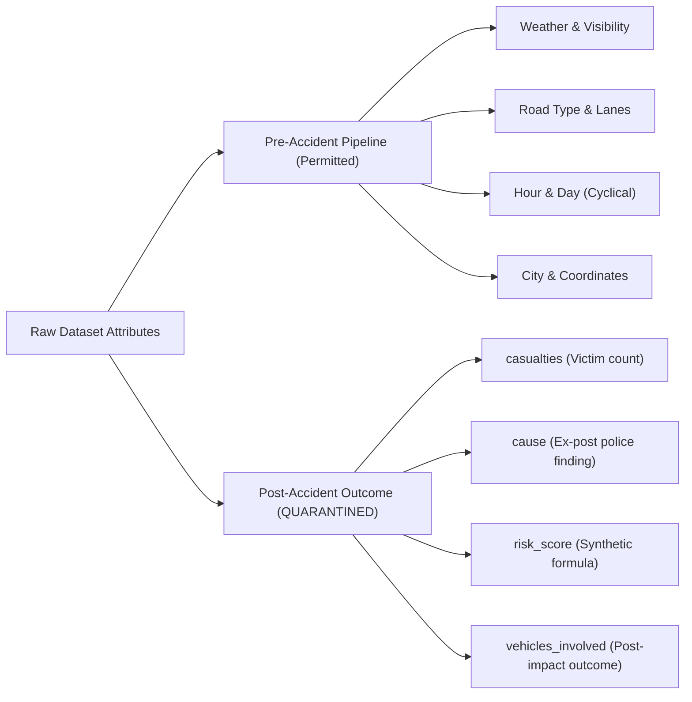

# AccidentVision AI — Feature Dictionary & Leakage Quarantine Registry

**Version:** 2.0  
**Status:** Scientifically Audited & Quarantined  
**Target:** `accident_severity` (`fatal`, `major`, `minor`)  

---

## 1. Feature Dictionary: Pre-Accident Feature Set

These features represent environmental, road infrastructure, and temporal indicators observable **prior** to accident occurrence. Only these variables are permitted in the predictive inference schema.

| Feature Name | Data Type | Units / Range | Missingness | Source | Pre-Accident Availability | Engineering / Transformation |
| :--- | :--- | :--- | :--- | :--- | :--- | :--- |
| `latitude` | `float64` | `8.0°` to `37.0°` N | 0 (0.0%) | Incident Telemetry | Yes (Location of roadway) | RobustScaler; Spatial Haversine clustering |
| `longitude` | `float64` | `68.0°` to `97.0°` E | 0 (0.0%) | Incident Telemetry | Yes (Location of roadway) | RobustScaler; Spatial Haversine clustering |
| `city` | `object` | 8 metropolitan centers | 0 (0.0%) | Administrative boundaries | Yes (Jurisdiction known) | OneHotEncoder (unseen handled gracefully) |
| `road_type` | `object` | `highway`, `urban`, `rural` | 0 (0.0%) | Road asset registry | Yes (Fixed infrastructure) | OneHotEncoder |
| `lanes` | `int64` | `1` to `8` lanes | 0 (0.0%) | Highway engineering | Yes (Physical asset) | RobustScaler; `is_multi_lane` indicator |
| `traffic_signal`| `int64` | `0` (Uncontrolled), `1` (Signalized) | 0 (0.0%) | Traffic control inventory | Yes (Physical infrastructure) | Binary passthrough |
| `weather` | `object` | `clear`, `rain`, `fog` | 0 (0.0%) | Meteorological observation | Yes (Pre-impact weather) | OneHotEncoder; `is_adverse_weather` binary |
| `visibility` | `object` | `low`, `medium`, `high` | 0 (0.0%) | Meteorological observation | Yes (Atmospheric state) | OneHotEncoder; `is_poor_visibility` binary |
| `temperature` | `float64` | `5.0°C` to `48.0°C` | 0 (0.0%) | Surface meteorological sensors | Yes (Ambient temperature) | RobustScaler |
| `traffic_density`| `object`| `low`, `medium`, `high` | 0 (0.0%) | Traffic surveillance/loop sensors | Yes (Pre-impact traffic flow) | OneHotEncoder |
| `hour` | `int64` | `0` to `23` | 0 (0.0%) | Clock timestamp | Yes (Time of travel) | Sin/Cos cyclical coordinate transforms |
| `day_of_week` | `object` | `Monday` to `Sunday` | 0 (0.0%) | Calendar | Yes (Day of travel) | OneHotEncoder & Sin/Cos cyclical transforms |
| `is_weekend` | `int64` | `0` (Mon-Fri), `1` (Sat-Sun) | 0 (0.0%) | Calendar | Yes (Calendar state) | Binary passthrough |
| `is_peak_hour` | `int64` | `0` (Off-peak), `1` (Rush hour) | 0 (0.0%) | Calendar / Traffic policy | Yes (Known time window) | Binary passthrough |
| `festival` | `object` | Festival name or `None` | 17,211 (86.1%) | Cultural calendar | Yes (Known calendar event) | Imputed to `"None"`, OneHotEncoder |
| `osm_highway` | `object` | `primary`, `secondary`, `residential`, etc. | 4,575 (22.88%) | OpenStreetMap vector layer | Yes (Static roadway network) | Imputed to `"missing"`, OneHotEncoder |
| `osm_road_length_m` | `float64` | `10.0m` to `8,500.0m` | 4,575 (22.88%) | OpenStreetMap road segment | Yes (Roadway length) | Median imputation, `log1p` transformation |
| `distance_to_road_m` | `float64` | `0.0m` to `200.0m` | 642 (3.21%) | OSM nearest-neighbor distance | Yes (Proximity to centerline) | Median imputation, `log1p` transformation |
| `road_match_quality` | `object` | `Good`, `Fair`, `Poor` | 642 (3.21%) | Spatial join confidence | Yes (Data quality indicator) | Imputed to `"missing"`, OneHotEncoder |

---

## 2. Quarantined Feature Registry (Ex-Post Target Leakage)

The following attributes are present in the raw dataset but **must be strictly quarantined** from model training and inference. Using any of these fields to predict severity constitutes an invalid experimental setup.

### 1. `casualties`
- **Definition:** Total count of individuals killed or injured in the crash.
- **Empirical Audit Finding:**
  - In fatal crashes: Exactly 0.0% of records have 0 casualties (uniform distribution across 1 to 5 casualties).
  - In non-fatal crashes: 29.0% have 0 casualties.
- **Why Quarantined:** Casualties are the *definition* and consequence of severity, not a pre-accident predictor. If a system knows that 3 people died or were injured, the accident has already occurred. Incorporating `casualties` into pre-crash severity prediction is textbook target leakage.

### 2. `risk_score`
- **Definition:** Numerical score between `0.10` and `1.00`.
- **Empirical Audit Finding:**
  - `risk_score` = `0.85`: 298 records $\rightarrow$ **100.0% Fatal**.
  - `risk_score` = `0.95`: 1 record $\rightarrow$ **100.0% Fatal**.
  - `risk_score` = `1.00`: 227 records $\rightarrow$ **100.0% Fatal**.
  - `risk_score` = `0.50`: 212 records $\rightarrow$ **99.5% Fatal**.
- **Why Quarantined:** The mathematical formula that generated `risk_score` in the raw repository was constructed ex-post and incorporates the severity label. Any model trained on `risk_score` merely reverses this synthetic formula rather than learning real-world risk signals.

### 3. `cause`
- **Definition:** Recorded police or investigation reason (e.g., `overspeeding`, `drunk driving`, `distraction`).
- **Empirical Audit Finding:** Conditional probability $P(\text{severity} \mid \text{cause})$ is virtually indistinguishable across categories (~15% fatal across all causes).
- **Why Quarantined:** In real-world deployment, the verified cause is established during post-accident collision reconstruction, not before the trip commences.

### 4. `vehicles_involved`
- **Definition:** Total number of vehicles damaged in the collision.
- **Why Quarantined:** The exact number of involved vehicles is an ex-post collision outcome. A pre-trip risk model cannot anticipate whether a multi-vehicle pileup or a single-vehicle roadside impact will unfold.

---

## 3. Preprocessing Transformations Applied

1. **Missing Value Imputation:**
   - Numerical columns: Median computed strictly from the 2022–2023 training partition.
   - Categorical columns: Most frequent mode computed strictly from the training partition.
   - Road features (`osm_highway`, `road_match_quality`): Explicit `"missing"` token category.

2. **Sinusoidal Cyclical Coordinates:**
   $$\text{hour\_sin} = \sin\left(\frac{2\pi \cdot \text{hour}}{24}\right), \quad \text{hour\_cos} = \cos\left(\frac{2\pi \cdot \text{hour}}{24}\right)$$
   $$\text{dow\_sin} = \sin\left(\frac{2\pi \cdot \text{dow\_num}}{7}\right), \quad \text{dow\_cos} = \cos\left(\frac{2\pi \cdot \text{dow\_num}}{7}\right)$$

3. **Road Geometry Non-Linear Scaling:**
   $$\text{log\_road\_length} = \ln(1 + \max(0, \text{osm\_road\_length\_m}))$$
   $$\text{log\_distance} = \ln(1 + \max(0, \text{distance\_to\_road\_m}))$$
