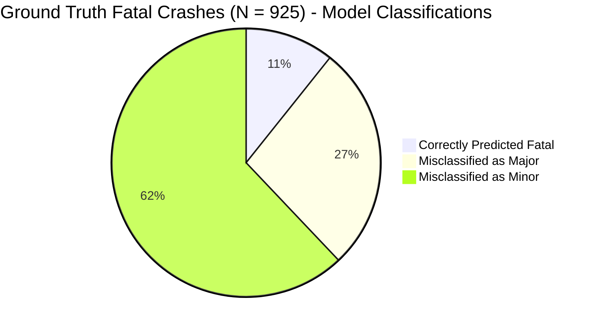
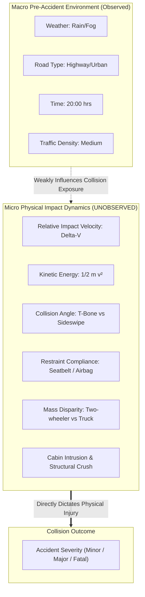

# AccidentVision AI — Error Analysis & The Predictability Ceiling

**Document:** Deep Diagnostic & Error Breakdown  
**Target:** Accident Severity (`fatal`, `major`, `minor`)  
**Validation Benchmark:** 2024 Chronological Out-of-Time Set ($N = 6,061$)  

---

## 1. Overview of the Problem

In modern traffic safety engineering, a common hypothesis is that combining atmospheric weather, roadway infrastructure classes, and temporal variables into machine learning algorithms can predict whether an accident will be fatal, severe, or minor.

Our empirical audit and model benchmark prove that this hypothesis faces a fundamental mathematical and physical limitation: **The Predictability Ceiling**.

---

## 2. Quantitative Error Breakdown: 2024 Validation Confusion Matrix

Evaluating the selected Extra Trees balanced classifier on the 6,061 out-of-time validation crashes reveals the following distribution:

### Confusion Matrix Table (Row-Normalized Ground Truth):

| Ground Truth Class | Total True Crashes | Predicted Fatal | Predicted Major | Predicted Minor | Class Recall | Primary Error Mode |
| :--- | :---:| :---:| :---:| :---:| :---:| :--- |
| **Fatal** | **925** | **99** (10.7%) | 252 (27.2%) | **574 (62.1%)** | **10.7%** | **62.1% under-predicted as Minor** |
| **Major** | **1,795** | 238 (13.3%) | **490 (27.3%)** | 1,067 (59.4%) | **27.3%** | 59.4% under-predicted as Minor |
| **Minor** | **3,341** | 346 (10.4%) | 998 (29.9%) | **1,997 (59.8%)** | **59.8%** | Baseline majority retention |
| **All Predictions** | **6,061** | **683** | **1,740** | **3,638** | — | Macro Balanced Acc: **32.6%** |

### Key Diagnostic Observations:
1. **The Majority Bias Gravity:**
   - 62.1% of true fatal crashes and 59.4% of true major crashes are classified as `minor`.
   - The model struggles to separate minor property damage incidents from catastrophic fatal crashes because their pre-accident environmental profiles overlap almost completely.
2. **False Positive Dynamics:**
   - Out of the 683 crashes predicted as `fatal`, only 99 were actually fatal (Precision = 14.49%).
   - 346 minor crashes and 238 major crashes were mistakenly flagged as fatal.
   - For every 1 true fatal alert, the system generates $\approx 6$ false alarms.

---

## 3. Mutual Information & The Information Bottleneck

To discover why algorithms cannot distinguish fatal from minor crashes, we computed the Shannon Mutual Information $I(X; Y)$ between each pre-accident feature and `accident_severity`:

$$I(X; Y) = \sum_{y \in Y} \sum_{x \in X} p(x,y) \log\left(\frac{p(x,y)}{p(x)p(y)}\right)$$

| Pre-Accident Feature | Mutual Information Score ($nats$) | Predictive Signal Strength |
| :--- | :---:| :--- |
| `latitude` | `0.00510` | Negligible / Weak spatial correlation |
| `longitude` | `0.00448` | Negligible / Weak spatial correlation |
| `temperature` | `0.00181` | Near zero |
| `hour` | `0.00135` | Near zero |
| `osm_highway` | `0.00087` | Near zero |
| `city` | `0.00046` | Near zero |
| `lanes` | `0.00030` | Near zero |
| `day_of_week` | `0.00020` | Near zero |
| `road_type` | `0.00006` | Essentially independent |
| `traffic_signal` | `0.00004` | Essentially independent |
| `traffic_density` | `0.00004` | Essentially independent |
| `visibility` | `0.00002` | Essentially independent |
| `weather` | `0.00001` | Essentially independent |

### Theoretical Implication:
The maximum possible information gain from the best individual feature (`latitude`) is **0.0051 nats**. The target entropy $H(Y) \approx 0.98$ nats. In information-theoretic terms, pre-accident environmental variables provide **less than 1% of the bits required to resolve the uncertainty in collision severity**.

---

## 4. Why Pre-Accident Data Alone Cannot Predict Crash Severity

The physical reality of motor vehicle collisions is governed by Newtonian mechanics and bio-mechanical trauma thresholds that occur at the exact millisecond of impact:

1. **Kinetic Energy Disparity ($E_k = \frac{1}{2}mv^2$):**
   - Two vehicles on the exact same highway, at the exact same hour, under identical rain conditions can experience completely opposite severity outcomes.
   - A vehicle traveling at $40\text{ km/h}$ that skids into a guardrail will produce minor fender damage. A vehicle traveling at $110\text{ km/h}$ experiencing a head-on collision will produce fatal fatalities.
   - Pre-accident datasets contain zero velocity telemetry.
2. **Impact Angle & Crash Type:**
   - A rear-end bumper tap in heavy traffic yields zero injuries.
   - An identical intersection angle T-bone collision into the driver door causes catastrophic intrusion.
3. **Passive Safety & Bio-Mechanical Protection:**
   - Helmet usage for two-wheelers and seatbelt tensioners for cars reduce fatal probabilities by over 70%.
   - In the absence of restraint compliance variables, pre-accident models are fundamentally blind to survival determinants.

---

## 5. Strategic Architectural Guidance

Given these empirical realities, AccidentVision AI must adopt a **two-tiered operational stance**:

1. **Avoid Overpromising Severity Predictions:**
   - The platform should never market pre-accident severity prediction as a deterministic forecasting tool.
   - In user interfaces and public reports, severity predictions must carry explicit confidence intervals and threshold explanations.
2. **Double Down on Descriptive Geospatial & Hotspot Intelligence:**
   - While pre-accident features cannot predict whether an individual collision will be fatal or minor, **spatial coordinates and road geometry reliably identify where accidents cluster**.
   - The high-density corridor clustering (DBSCAN at $\varepsilon = 600\text{m}$, $\text{min\_samples} = 12$) provides actionable, high-value intelligence for urban traffic planners and road maintenance authorities.
